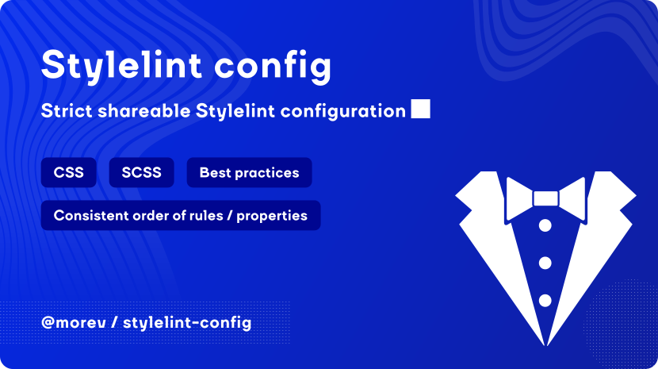

[](https://opensource.org/licenses/MIT)


# @morev/stylelint-config

Strict shareable Stylelint configuration with reasonable defaults.

✔️ 200+ configured rules of Stylelint and its plugins; \
✔️ 70+ extra rules for SCSS; \
✔️ Consistent order of properties and rules according to BEM methodology.

---

## Installation

### Using `yarn`

```sh
yarn add stylelint @morev/stylelint-config --dev
```

### Using `npm`

```sh
npm install -D stylelint @morev/stylelint-config
```

### Using `pnpm`

```sh
pnpm add -d stylelint @morev/stylelint-config
```

## Usage

Create a [Stylelint configuration file](https://stylelint.io/user-guide/configure/)
(`stylelint.config.ts` for the following instruction) in the package root with the following content:

### SCSS repository

```js
import { defineConfig, definePreset } from '@morev/stylelint-config';

export default defineConfig(definePreset('scss'));
```

### CSS repository

```js
import { defineConfig, definePreset } from '@morev/stylelint-config';

export default defineConfig(definePreset('css'));
```

### Mixed repository

```js
import { defineConfig, definePreset } from '@morev/stylelint-config';

export default defineConfig(
  definePreset('css', { files: ['*.css'] }),
  definePreset('scss', { files: ['*.scss'] }),
);
```

`defineConfig` accepts regular Stylelint config objects and merges them into a
single config. A config object with a top-level `files` property is treated as a
flat item and lowered to `overrides`.

### Custom rules

`definePreset` accepts rule overrides in regular Stylelint format. Use callbacks
only when a project needs to modify package defaults instead of replacing them.
Each callback receives the current rule value normalized as
`[primary, secondary?]`. A callback can mutate the builder directly or return it
for chaining. The callback `secondary` value contains only rule-specific options;
shared Stylelint options like
`severity`, `disableFix`, `message`, `reportDisables`, and `url` are exposed
through `rule.stylelintOptions` and managed by dedicated builder methods.

The available rule names and callback value types follow the selected preset:
`css` exposes CSS rules, while `scss` exposes CSS rules plus SCSS-specific
plugin rules.

```js
import { defineConfig, definePreset } from '@morev/stylelint-config';

export default defineConfig(definePreset('css', {
  rulesDiagnostics: 'warn',
  rules: {
    // Regular Stylelint values replace the package defaults.
    'selector-type-no-unknown': null,
    'color-hex-length': ['short', { severity: 'warning' }],

    // Callbacks are useful when project rules should extend package defaults.
    'font-weight-notation': (rule) => {
      const [primary, secondary] = rule.value;
      const { severity } = rule.stylelintOptions;
      const nextSeverity = severity === 'warning' ? 'error' : 'warning';

      return rule
        .setValue([primary, {
          ignore: [...secondary.ignore, 'named'],
        }])
        .setStylelintOptions({ reportDisables: true })
        .setSeverity(nextSeverity)
        .disableFix();
    },

    'declaration-block-no-redundant-longhand-properties': (rule) => {
      const [, secondary] = rule.value;

      return rule
        .setSecondary({
          ...secondary,
          ignoreShorthands: [
            ...secondary.ignoreShorthands,
            'columns',
          ],
        });
    },

    'property-no-vendor-prefix': (rule) => {
      const [, secondary] = rule.value;

      return rule
        .setSecondary({
          ...secondary,
          ignoreProperties: [
            ...secondary.ignoreProperties,
            '-webkit-appearance',
          ],
        })
        .setSeverity('error')
        .enableFix();
    },
  },
}));
```

The same API is available for SCSS configs:

```js
import { defineConfig, definePreset } from '@morev/stylelint-config';

export default defineConfig(
  definePreset('scss', {
    rules: {
      // Regular Stylelint values replace SCSS package defaults.
      'csstools/use-nesting': ['always', {
        syntax: 'scss',
        except: [':selection'],
      }],

      // Callbacks can extend existing SCSS rule options.
      'scss/at-rule-no-unknown': (rule) => {
        const [, secondary] = rule.value;

        return rule
          .setSecondary({
            ignoreAtRules: [
              ...secondary.ignoreAtRules,
              'tailwind',
            ],
          })
          .setSeverity('warning');
      },
    },
  })
);
```

Scoped preset items receive rule overrides locally, with CSS items typed as CSS
and SCSS items typed as SCSS:

```js
import { defineConfig, definePreset } from '@morev/stylelint-config';

export default defineConfig(
  definePreset('css', {
    files: ['*.css'],
    rules: {
      'color-hex-length': ['short', { severity: 'warning' }],
    },
  }),
  definePreset('scss', {
    files: ['*.scss'],
    rules: {
      'scss/at-rule-no-unknown': (rule) => {
        const [, secondary] = rule.value;

        return rule.setSecondary({
          ...secondary,
          ignoreAtRules: [
            ...secondary.ignoreAtRules,
            'tailwind',
          ],
        });
      },
    },
  }),
);
```

The builder methods are intentionally explicit: `setValue`, `setPrimary`,
`setSecondary`, `setStylelintOptions`, `setSeverity`, `disable`, `disableFix`,
and `enableFix`. The `setSecondary` method is available only for rules that
define rule-specific secondary options. It accepts either a replacement object
or a callback that receives the current rule-specific secondary options.
Redundant setter calls are reported with `console.warn` by default; set
`rulesDiagnostics` to `off`, `warn`, or `error` to control that behavior.

### Custom order

`defineConfig` accepts project-specific rules order overrides without redefining the whole
[`order/order`](https://github.com/hudochenkov/stylelint-order/blob/master/rules/order/README.md)
value.

The `order` option intentionally supports only configurable project
groups:

- `mixins`
- `blockMixins`
- `mediaQueries`
- `containerQueries`.

Use it when a project has its own mixins, custom media, or container query conventions
that should be sorted near the built-in groups while the rest of the package order
stays managed by this config.

```js
import { defineConfig, definePreset } from '@morev/stylelint-config';

export default defineConfig(definePreset('scss', {
  order: {
    // Arrays replace the default values for the group.
    mixins: ['theme-dark'],
    blockMixins: ['responsive'],
    // The callback return value also replaces defaults; spread them to extend instead.
    mediaQueries: (mediaQueries) => [
      '--watch',
      ...mediaQueries,
      '--ultra-wide',
    ],
    containerQueries: [],
  },
}), {
  // Rest elements can extend the config in Stylelint format.
  rules: {
    'selector-max-id': null,
  },
});
```

### Exported order values

The raw default order values are also exported for advanced Stylelint configuration:

```js
import {
  PROPERTIES_ORDER,
  RULES_ORDER,
  defineConfig,
} from '@morev/stylelint-config';

export default defineConfig({
  rules: {
    'order/order': [RULES_ORDER, { severity: 'warning' }],
    'order/properties-order': [PROPERTIES_ORDER, { severity: 'warning' }],
  },
});
```

### BEM component files

Use `definePreset('bem')` as a scoped wrapper around
[`@morev/stylelint-plugin`](https://morevm.github.io/stylelint-plugin/) for BEM component files,
which usually make up only part of a repository.

```js
import { defineConfig, definePreset } from '@morev/stylelint-config';

export default defineConfig(
  definePreset('scss'),
  definePreset('bem', {
    files: [
      './src/components/**/*.{css,scss}',
      './src/blocks/**/*.{css,scss}',
    ],
    separators: {
      element: '__',
      modifier: '--',
      modifierValue: '--',
    },
    rules: {
      // Extends the default rule: keeps built-in presets and adds a project exception.
      '@morev/bem/no-block-properties': (rule) => {
        const [, secondary] = rule.value;

        return rule.setSecondary({
          ...secondary,
          allowProperties: [
            ...secondary.allowProperties,
            'position',
          ],
        });
      },

      // Replaces the default rule: the value below is used as-is.
      '@morev/bem/no-side-effects': [true, {
        ignore: ['.swiper-*'],
      }],
    },
  }),
);
```
